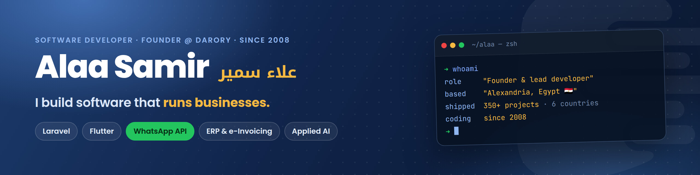

  

<h2 align="center">Hi, I'm Alaa Samir 👋</h2>

  Software developer since 2008 and founder of <a href="https://darory.com"><b>Darory</b></a>, a software house and cloud hosting company in Alexandria, Egypt 🇪🇬. 
  I turn business workflows into systems that actually run: <b>350+ projects</b> for clients in <b>6 countries</b>.

  
  
  

---

### 🧑‍💻 About me

- 🏢 Building **ERP, accounting and e-invoicing systems** for growing companies
- 💬 Connecting businesses to customers with **WhatsApp API** integrations and automation
- 📱 Shipping **cross-platform mobile apps** with Flutter
- ⚡ Real-time backends with **Laravel, Livewire and Reverb**
- 🤖 Using **AI in real projects**, not just demos
- 🎥 Sharing the lessons of 17+ years in software, in Egyptian Arabic, on my series *أخطاء البداية*

### 🛠️ Tech I use every day

  
  
  
  
  
  
  
  
  
  

### 📦 Open source

| Project | What it does |
|---|---|
| [**darory/whatsapp**](https://github.com/darory/whatsapp) | PHP & Laravel SDK for the Darory WhatsApp API: send messages, media and locations from your app | 

### 🤝 Let's work together

Need a system to replace spreadsheets, a mobile app, or a WhatsApp integration for your business?
Message me on [WhatsApp](https://wa.me/201022983211) or email [info@darory.com](mailto:info@darory.com).

Made with ❤️ in Alexandria, Egypt

